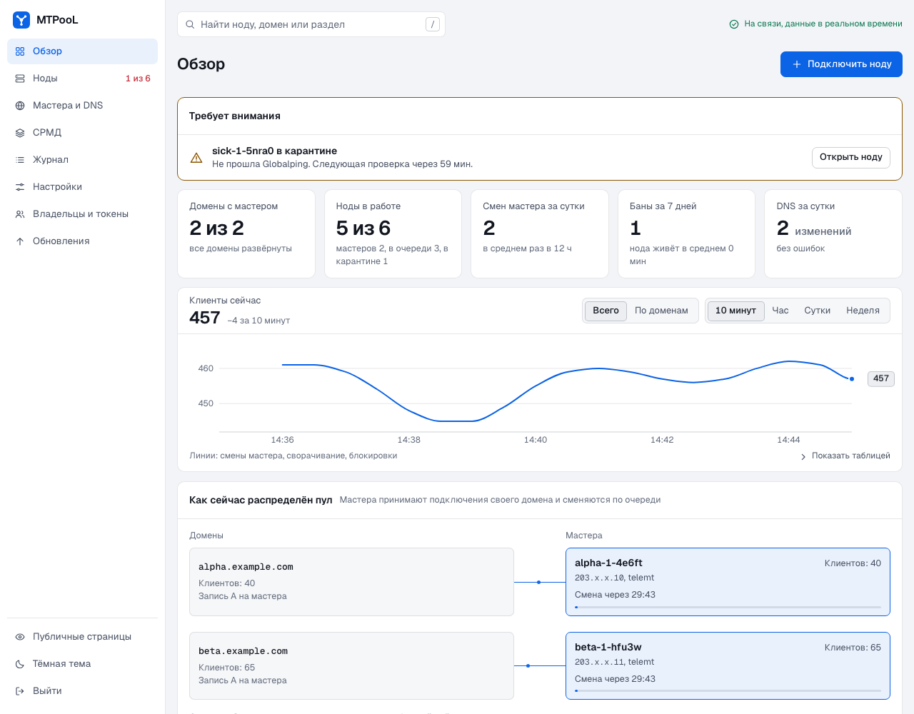
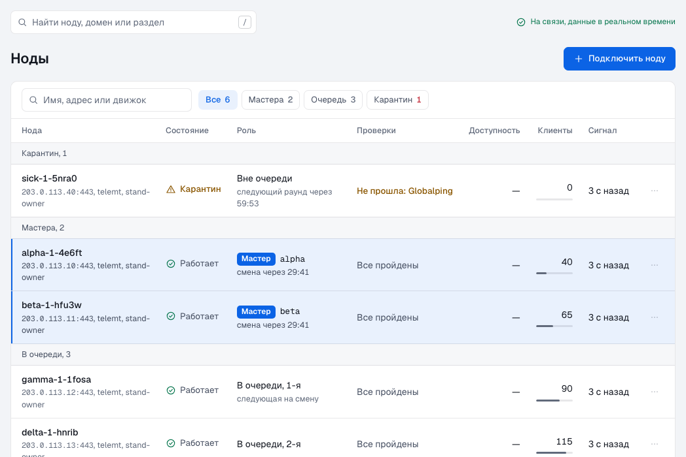
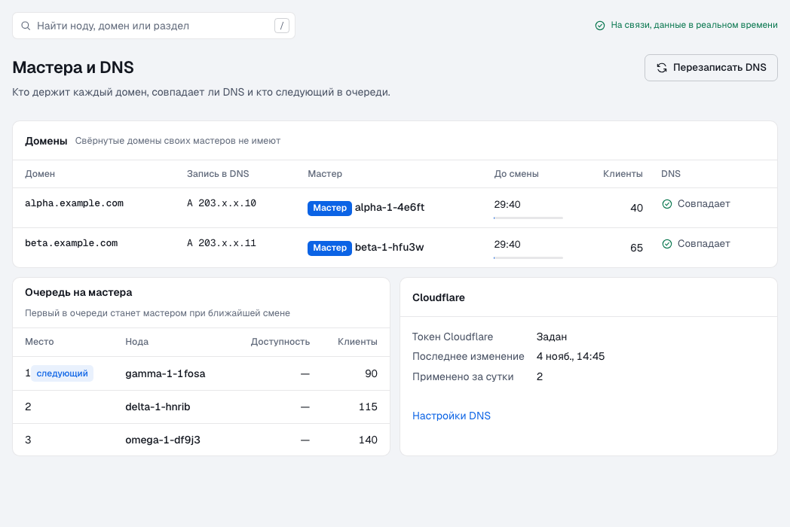
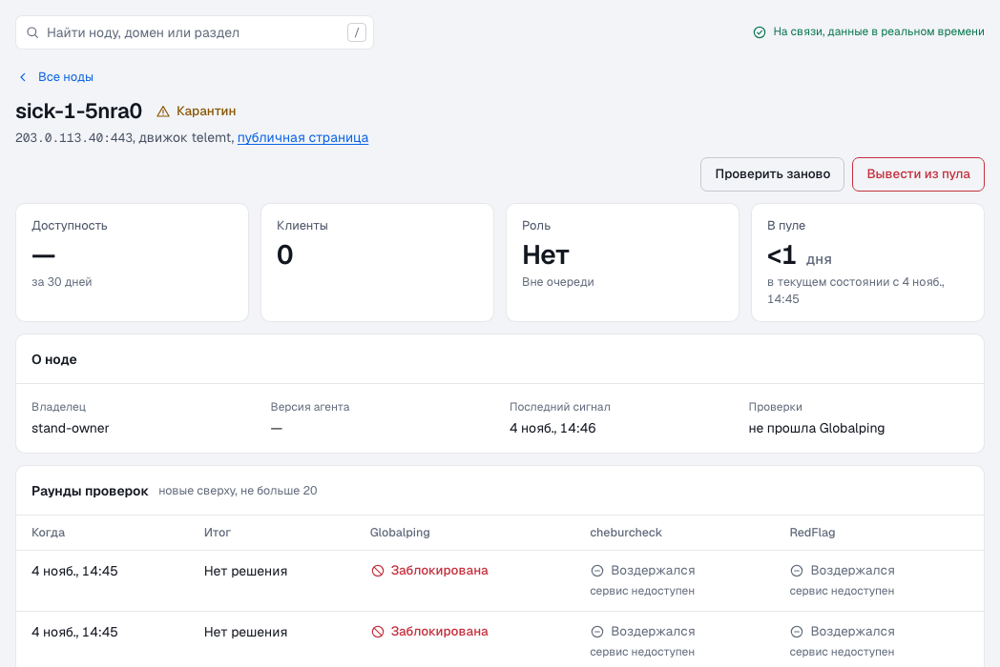
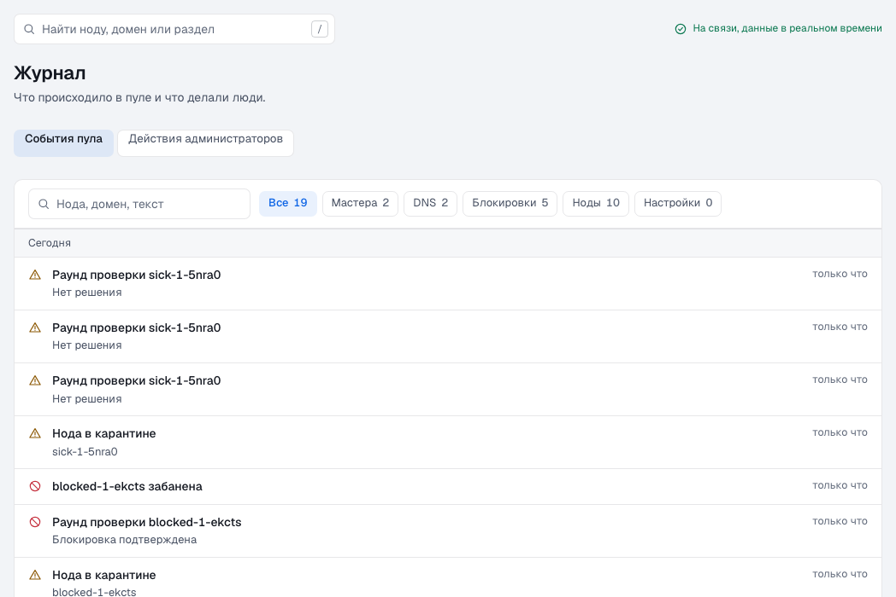
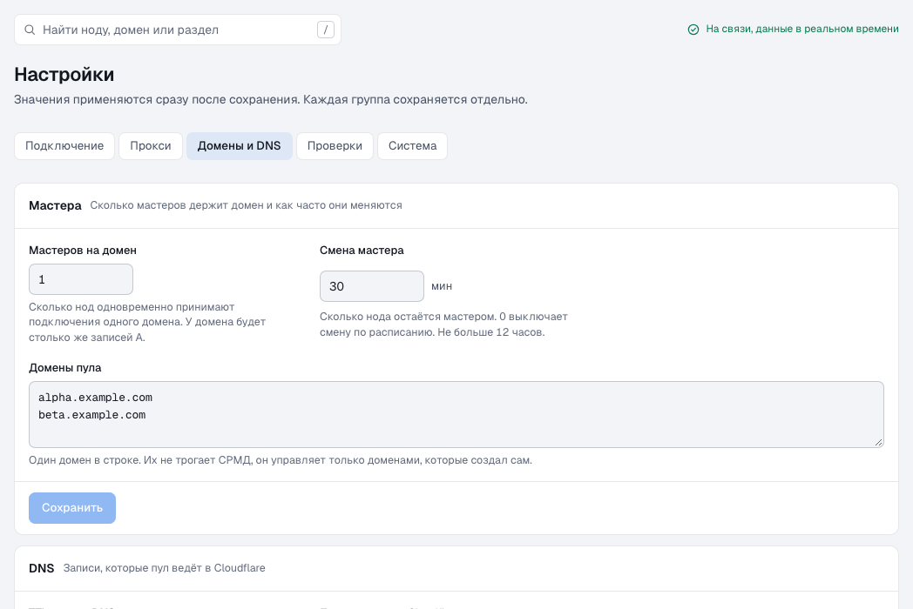
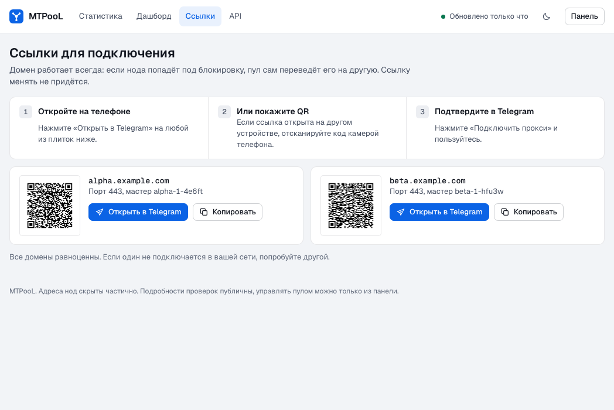
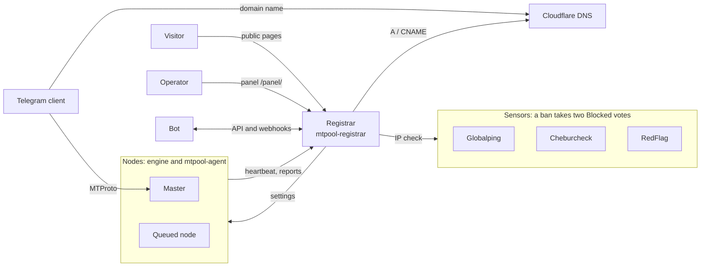
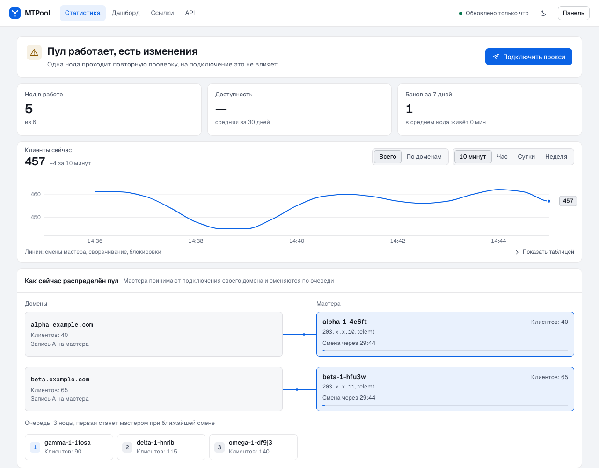

<div align="center">


# MTPooL

A pool of MTProto proxies for Telegram. One permanent link for clients, healthy servers behind it, and a ban only after independent sensors confirm the block.

[](https://github.com/SkyDeaD/MTPooL/actions/workflows/ci.yml)
[](https://github.com/SkyDeaD/MTPooL/releases)
[](LICENSE)
[](docs/development.md)
[](docs/development.md)
[](docs/openapi.json)<br>
[](docs/add-node.md)
[](docs/operations.md)

[Русский](README.md) | **English**

</div>

> [!NOTE]
> The first release is not out yet. The installers download binaries from GitHub Releases, so the quick start works once it is published. The end-to-end scenarios pass on a test stand, and the check on a real server comes before the release.

<picture><source media="(prefers-color-scheme: dark)" srcset="docs/images/panel-dark.png"></picture>

## Why it exists

A plain proxy link lives as long as its server. When that server goes down or gets blocked, every client needs a new link.

MTPooL separates the link from the server. Clients connect to a domain, and the pool points it at a node that works right now. The pool takes a broken node off the domain by itself, and the link stays the same.

The project fits if you run several servers with telemt, MTProxyL or MEKO, alone or together with other owners.

## Features

**The pool**

- **Joining by token.** A node joins with one command, and the agent finds the installed engine by itself. Your configuration is extended, not overwritten.
- **Masters and rotation.** A master is a node a domain points at right now. The pool picks masters from the queue of healthy nodes and by default changes them every 30 minutes. The next node replaces a master that fails.
- **DNS in Cloudflare.** Pool records carry the comment `MTPooL`, and the pool leaves the rest of the zone alone. Optionally, the pool fits the number of domains to the size of the queue.
- **A ban only on confirmation.** An IP is blocked when at least two sensors out of three see the block: Globalping, Cheburcheck and RedFlag. A faulty sensor does not vote, and a server that is switched off counts as dead, not blocked.

**People and bots**

- **Public pages.** Statistics, proxy links with QR codes and the API reference, without a login. Node addresses are masked: `203.x.x.113`.
- **Panel.** Nodes, domains, journal, settings, owners and tokens, updates. The interface is in Russian, has light and dark themes, and works on a phone.
- **API and monitoring.** A REST API with an OpenAPI specification, bot tokens, HMAC-signed webhooks, Prometheus metrics.

**Upkeep**

- **Signed updates.** The registrar and the agents install releases themselves and check the `minisign` signature. Agents update in batches, with a trial node first. On a failure the version rolls back and the rollout stops.
- **Node protection.** The agent can drop known scanners using the IPsum list.
- **Simple install.** The registrar is one binary with SQLite and the interface built in, with Caddy in front for TLS. No external databases or queues.

## What it looks like

<table>
  <tr>
    <td width="50%"><a href="docs/images/panel-nodes-light.png"><picture><source media="(prefers-color-scheme: dark)" srcset="docs/images/panel-nodes-dark.png"></picture></a><br><b>Nodes.</b> Masters, queue and quarantine in one list.</td>
    <td width="50%"><a href="docs/images/panel-masters-light.png"><picture><source media="(prefers-color-scheme: dark)" srcset="docs/images/panel-masters-dark.png"></picture></a><br><b>Masters.</b> Which domain points at which node now.</td>
  </tr>
  <tr>
    <td width="50%"><a href="docs/images/panel-node-light.png"><picture><source media="(prefers-color-scheme: dark)" srcset="docs/images/panel-node-dark.png"></picture></a><br><b>Node.</b> Sensor votes round by round: one vote is not enough for a ban.</td>
    <td width="50%"><a href="docs/images/panel-journal-light.png"><picture><source media="(prefers-color-scheme: dark)" srcset="docs/images/panel-journal-dark.png"></picture></a><br><b>Journal.</b> What the pool decided, and when.</td>
  </tr>
  <tr>
    <td width="50%"><a href="docs/images/panel-settings-light.png"><picture><source media="(prefers-color-scheme: dark)" srcset="docs/images/panel-settings-dark.png"></picture></a><br><b>Settings.</b> Domains, DNS, checks and system, in groups.</td>
    <td width="50%"><a href="docs/images/public-links-light.png"><picture><source media="(prefers-color-scheme: dark)" srcset="docs/images/public-links-dark.png"></picture></a><br><b>Links.</b> The public page for clients, with QR codes.</td>
  </tr>
</table>

## How it works



- **Node:** a server with an MTProto engine and the `mtpool-agent` agent. The agent reports health and applies pool settings.
- **Registrar:** one service, `mtpool-registrar`: HTTP API, SQLite database, sensors, DNS, webhooks, public pages and panel.
- **Sensors:** outside services that check whether an IP is blocked from Russia. They vote `Blocked`, `Clear` or `Abstain`. A sensor fault or an unfamiliar answer gives `Abstain`, which is not a vote.

More, in Russian: [node lifecycle and ban logic](docs/lifecycle.md), [sensors and their limits](docs/sensors.md).

<picture><source media="(prefers-color-scheme: dark)" srcset="docs/images/public-dark.png"></picture>

## Quick start

You need:

- a server with Ubuntu 24.04 (x86_64 or aarch64) for the registrar, with ports 80 and 443 open;
- a name such as `pool.example.com` with an A record pointing at that server, created by hand;
- a Cloudflare zone for the pool domains and an API token that can edit DNS in that zone;
- at least one server with Ubuntu or Debian for a node.

1. Clone the repository on the registrar server.

   ```bash
   git clone https://github.com/SkyDeaD/MTPooL.git && cd MTPooL
   ```

2. Install the registrar, using your name instead of `pool.example.com`. The script prints the admin token once, so save it.

   ```bash
   sudo sh deploy/install-registrar.sh --domain pool.example.com
   ```

3. Open `https://pool.example.com/panel/` and log in with the admin token.
4. In the settings, set the pool domains and the service keys.
5. Create an owner and issue an enrollment token for them.
6. On the node server, run the installer, using that token instead of `<token>`.

   ```bash
   curl -fsSL https://pool.example.com/install.sh | sudo env MTPOOL_TOKEN=<token> sh -s -- --name node1
   ```

The node appears in the panel as `Pending` and moves to `Healthy` after its first valid report. Proxy links for clients are at `https://pool.example.com/links/`.

All parameters and options, in Russian: [installing the registrar](docs/install-registrar.md), [adding a node](docs/add-node.md).

## API

Public routes work without a token:

```bash
curl -s https://pool.example.com/api/v1/links
```

Your pool's `/api/` page has the reference with examples, and the specification is in [docs/openapi.json](docs/openapi.json). For automation, see the [guide for bots](docs/bots.md), in Russian.

## Performance

| What was measured | Target | Result |
|---|---|---|
| `heartbeat`, p99, 1,000 nodes | under 20 ms | 6.76 ms |
| `GET /api/v1/nodes`, p99, 1,000 nodes | under 20 ms | 2.70 ms |
| Registrar memory over 30 minutes, 1,000 nodes | none | peak 132 MB |
| Agent: idle memory and binary size | under 20 MB and 15 MB | enforced by a test |
| JS of a public page, gzip | at most 50 KB | at most 31 KB |

A node simulator produced the load on a local Docker stand. A real server will give different numbers.

## Documentation

The guides are in Russian.

| For | Document | About |
|---|---|---|
| Pool operators | [Installing the registrar](docs/install-registrar.md) | server, Cloudflare, service keys |
| Pool operators | [Sensors](docs/sensors.md) | Globalping, Cheburcheck, RedFlag and their limits |
| Pool operators | [Lifecycle](docs/lifecycle.md) | node states, bans, masters, DNS |
| Pool operators | [Operations](docs/operations.md) | updates, rollback, backups, diagnostics |
| Node owners | [Adding a node](docs/add-node.md) | `install.sh`, `agent.toml`, leaving the pool |
| Bot authors | [Bots and webhooks](docs/bots.md) | API, signatures, moving from an old pool |
| Developers | [Development](docs/development.md) | build, tests, repository layout |

## Development

You need Rust and Node.js, plus Docker for the end-to-end scenarios. Run the tests:

```bash
cargo test --workspace
```

The other checks are in the [development guide](docs/development.md).

## Thanks and license

MTPooL is written from scratch and borrows no code. The ideas and the behaviour of the pool come from [sharedd](https://github.com/ugDeDe/sharedd). Thanks to its author.

[MIT](LICENSE) license. Third-party components are listed in [NOTICE](NOTICE).
