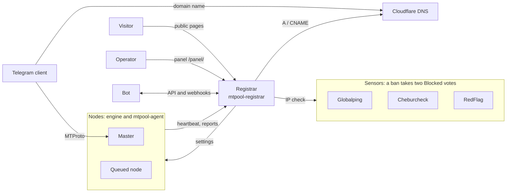

# MTPooL

[Русский](README.md)

MTPooL is a pool of MTProto proxies. Servers join the pool with a token. The pool watches their health, picks masters, keeps DNS in Cloudflare, and bans an IP only after independent sensors confirm the block.

<picture>
  <source media="(prefers-color-scheme: dark)" srcset="docs/images/panel-dark.png">
  
</picture>

Credit for the original idea is in [NOTICE](NOTICE). The documentation in `docs/` is in Russian, and so is the interface; this page is the English summary.

## What it does

- **Token enrollment.** A node joins with one command. The engine (telemt, MTProxyL or MEKO) is detected, and your configuration is added to, not overwritten.
- **Masters and rotation.** The pool decides which nodes the domains point at and rotates them. A failed master is replaced by the next node.
- **DNS in Cloudflare.** Pool records carry the comment `MTPooL`; other records in the zone are left alone. It can add domains as the queue grows.
- **Bans only on confirmation.** An IP is blocked when at least two of three independent sensors see the block. A broken sensor does not vote.
- **Public pages.** Statistics, proxy links with QR codes and the API reference, open to everyone. Node addresses are partly hidden.
- **Panel.** Nodes, domains, journal, settings, owners and tokens, updates. Light and dark themes.
- **Bots and monitoring.** A REST API with an OpenAPI specification, HMAC-signed webhooks, Prometheus metrics.
- **Signed updates.** The registrar and the agents install releases themselves, `minisign` checks the signature, and a failed version rolls back.

## How it works



- **Node**: a server with an MTProto engine (telemt, MTProxyL or MEKO) and the `mtpool-agent` service. The agent reports health and applies the pool's settings.
- **Registrar**: one service, `mtpool-registrar`: HTTP API, SQLite database, sensors, DNS, webhooks, public pages and the panel.
- **Master**: the node a domain's DNS record points to right now. The pool chooses masters itself and rotates them every 30 minutes by default.
- **Ban**: only when at least two sensors vote `Blocked`. A broken sensor or an unknown answer gives `Abstain`, which is not a vote.

<picture>
  <source media="(prefers-color-scheme: dark)" srcset="docs/images/public-dark.png">
  
</picture>

## Quick start

You need an Ubuntu 24.04 server for the registrar, a name such as `pool.example.com` that points at it (a record you create by hand), and a Cloudflare zone for the pool's domains.

1. Clone the repository and install the registrar from `deploy/` (parameters: [install-registrar.md](docs/install-registrar.md)). The script prints the admin token once.

   ```bash
   sudo sh deploy/install-registrar.sh --domain pool.example.com
   ```

2. Open `https://pool.example.com/panel/`, sign in with the admin token, set the pool domains and the service keys.
3. Issue an enroll token for an owner and connect a node:

   ```bash
   curl -fsSL https://pool.example.com/install.sh | sudo env MTPOOL_TOKEN=<token> sh -s -- --name node1
   ```

## Documentation (Russian)

| Document | Topic |
|---|---|
| [docs/install-registrar.md](docs/install-registrar.md) | registrar install, Cloudflare, service keys |
| [docs/add-node.md](docs/add-node.md) | adding a node, `install.sh`, `agent.toml` |
| [docs/sensors.md](docs/sensors.md) | Globalping, Cheburcheck, RedFlag and their limits |
| [docs/lifecycle.md](docs/lifecycle.md) | node states, ban, reverify, masters, DNS, domain scaling |
| [docs/bots.md](docs/bots.md) | bot API, webhooks, migrating from the old pool |
| [docs/operations.md](docs/operations.md) | updates, rollback, backups, diagnostics |
| [docs/development.md](docs/development.md) | building, tests, repository layout |
| [docs/openapi.json](docs/openapi.json) | API specification |

## License

The license is in [LICENSE](LICENSE); third-party components are listed in [NOTICE](NOTICE).
