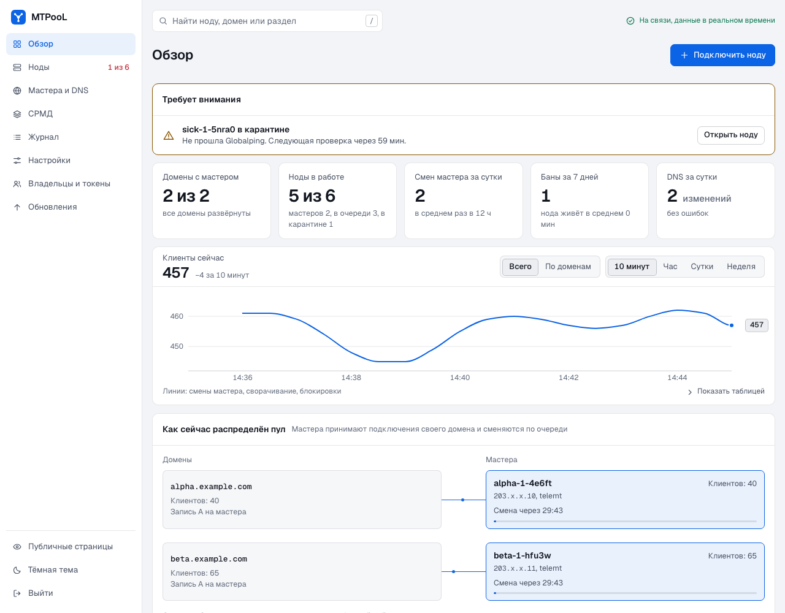
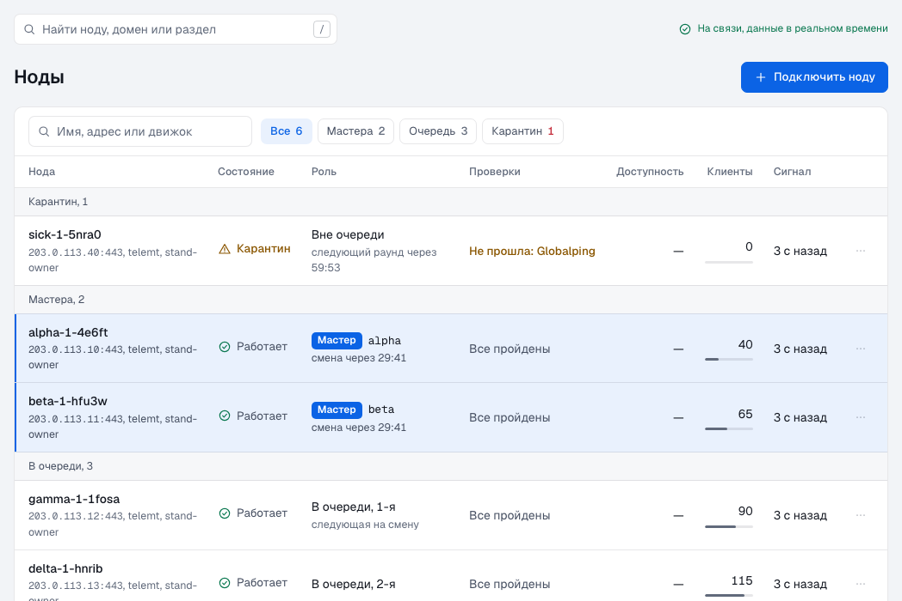
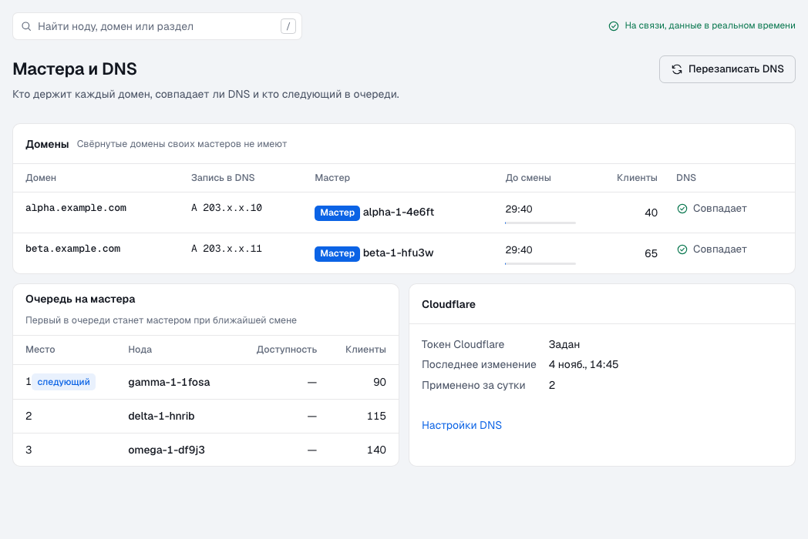
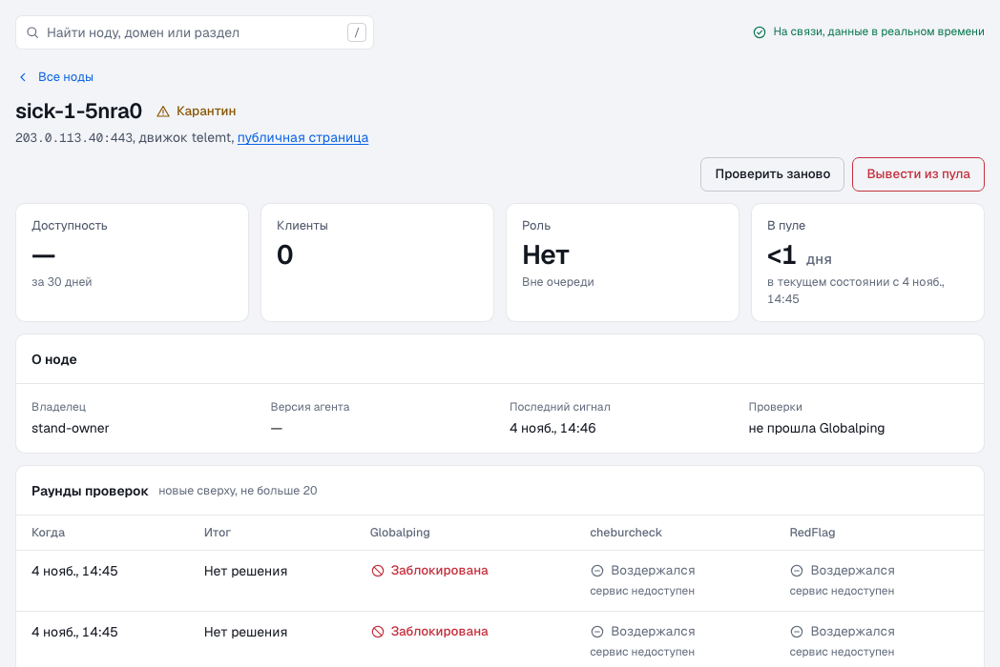
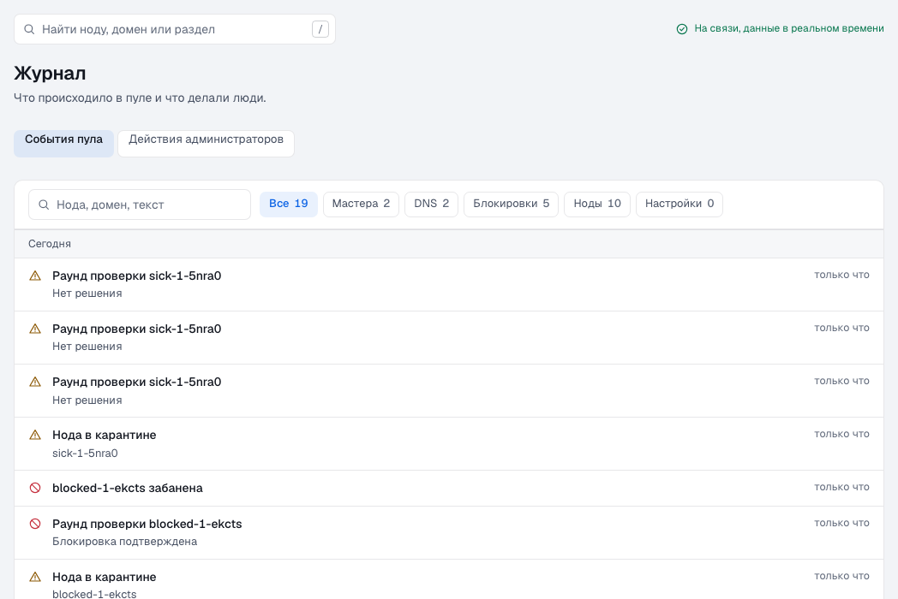
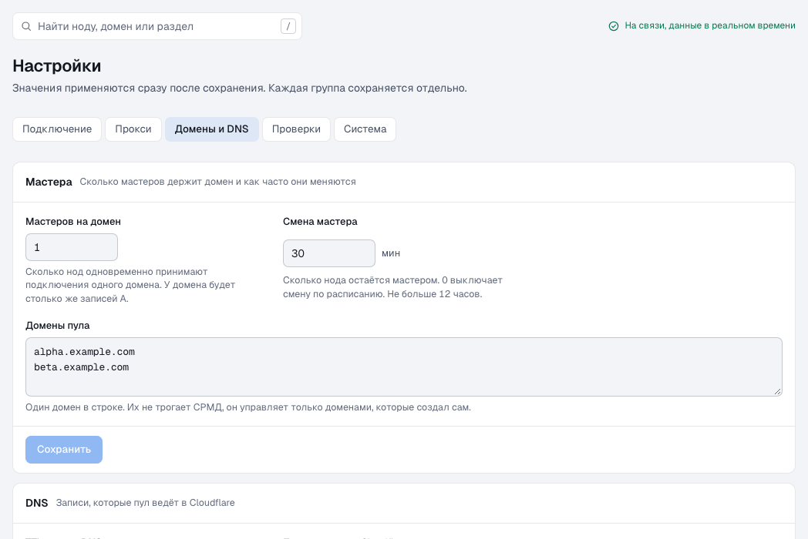
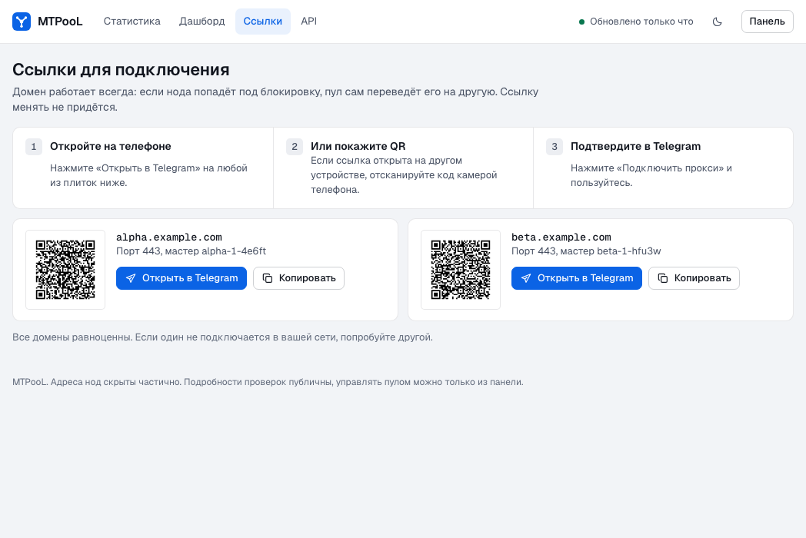
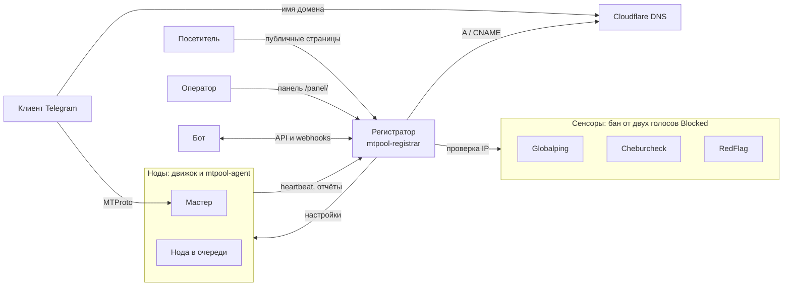
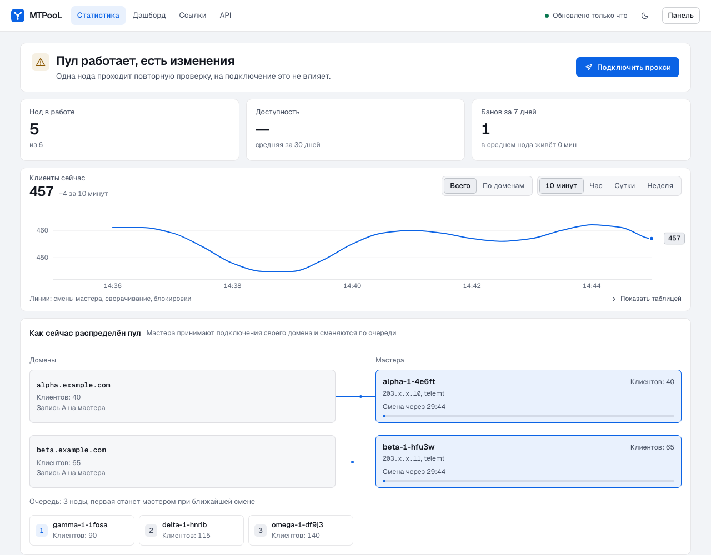

<div align="center">


# MTPooL

Пул MTProto-прокси для Telegram. Одна постоянная ссылка для клиентов, здоровые серверы за ней и бан только после подтверждения независимыми сенсорами.

[](https://github.com/SkyDeaD/MTPooL/actions/workflows/ci.yml)
[](https://github.com/SkyDeaD/MTPooL/releases)
[](LICENSE)
[](docs/development.md)
[](docs/development.md)
[](docs/openapi.json)<br>
[](docs/add-node.md)
[](docs/operations.md)

**Русский** | [English](README.en.md)

</div>

> [!NOTE]
> Первый релиз ещё не вышел. Установщики скачивают бинарники из GitHub Releases, поэтому быстрый старт заработает после его публикации. Сквозные сценарии проходят на тестовом стенде, проверка на настоящем сервере идёт перед релизом.

<picture><source media="(prefers-color-scheme: dark)" srcset="docs/images/panel-dark.png"></picture>

## Зачем это нужно

Обычная прокси-ссылка живёт, пока жив её сервер. Упал он или его заблокировали, и ссылку приходится менять у всех клиентов.

MTPooL отделяет ссылку от сервера. Клиенты подключаются к домену, а пул направляет его на ноду, которая исправна прямо сейчас. Сломанную ноду пул снимает с домена сам, ссылка остаётся прежней.

Проект подойдёт, если вы держите несколько серверов с telemt, MTProxyL или MEKO, в том числе вместе с другими владельцами.

## Что умеет

**Пул**

- **Подключение по токену.** Нода входит в пул одной командой, агент сам находит установленный движок. Ваша конфигурация дополняется, а не перезаписывается.
- **Мастера и ротация.** Мастер — нода, на которую сейчас указывает домен. Пул выбирает мастеров из очереди здоровых нод и по умолчанию меняет раз в 30 минут. Упавшего мастера заменяет следующая нода.
- **DNS в Cloudflare.** Записи пула помечены комментарием `MTPooL`, остальные записи зоны он не трогает. По желанию пул сам подбирает число доменов под размер очереди.
- **Бан только по подтверждению.** IP блокируется, когда блокировку видят минимум два сенсора из трёх: Globalping, Cheburcheck и RedFlag. Неисправный сенсор не голосует, а выключенный сервер считается мёртвым, а не заблокированным.

**Люди и боты**

- **Публичные страницы.** Статистика, прокси-ссылки с QR-кодами и описание API, без входа. Адреса нод скрыты: `203.x.x.113`.
- **Панель.** Ноды, домены, журнал, настройки, владельцы и токены, обновления. Интерфейс на русском, в светлой и тёмной теме, работает и на телефоне.
- **API и мониторинг.** REST API со спецификацией OpenAPI, токены ботов, webhooks с подписью HMAC, метрики Prometheus.

**Сопровождение**

- **Подписанные обновления.** Регистратор и агенты сами ставят релизы и проверяют подпись `minisign`. Агенты обновляются партиями, сначала пробная нода. При сбое версия откатывается, а раскатка останавливается.
- **Защита нод.** Агент может отбрасывать известные сканеры по списку IPsum.
- **Простая установка.** Регистратор — один бинарник со встроенными SQLite и интерфейсом, перед ним Caddy для TLS. Внешние базы и очереди не нужны.

## Как выглядит

<table>
  <tr>
    <td width="50%"><a href="docs/images/panel-nodes-light.png"><picture><source media="(prefers-color-scheme: dark)" srcset="docs/images/panel-nodes-dark.png"></picture></a><br><b>Ноды.</b> Мастера, очередь и карантин одним списком.</td>
    <td width="50%"><a href="docs/images/panel-masters-light.png"><picture><source media="(prefers-color-scheme: dark)" srcset="docs/images/panel-masters-dark.png"></picture></a><br><b>Мастера.</b> Какой домен на какую ноду указывает сейчас.</td>
  </tr>
  <tr>
    <td width="50%"><a href="docs/images/panel-node-light.png"><picture><source media="(prefers-color-scheme: dark)" srcset="docs/images/panel-node-dark.png"></picture></a><br><b>Нода.</b> Голоса сенсоров по раундам: одного голоса для бана мало.</td>
    <td width="50%"><a href="docs/images/panel-journal-light.png"><picture><source media="(prefers-color-scheme: dark)" srcset="docs/images/panel-journal-dark.png"></picture></a><br><b>Журнал.</b> Что и когда решил пул.</td>
  </tr>
  <tr>
    <td width="50%"><a href="docs/images/panel-settings-light.png"><picture><source media="(prefers-color-scheme: dark)" srcset="docs/images/panel-settings-dark.png"></picture></a><br><b>Настройки.</b> Домены, DNS, проверки и система, по группам.</td>
    <td width="50%"><a href="docs/images/public-links-light.png"><picture><source media="(prefers-color-scheme: dark)" srcset="docs/images/public-links-dark.png"></picture></a><br><b>Ссылки.</b> Публичная страница для клиентов, с QR-кодами.</td>
  </tr>
</table>

## Как это работает



- **Нода** — сервер с MTProto-движком и агентом `mtpool-agent`. Агент сообщает о здоровье и применяет настройки пула.
- **Регистратор** — один сервис `mtpool-registrar`: HTTP API, база SQLite, сенсоры, DNS, webhooks, публичные страницы и панель.
- **Сенсоры** — внешние сервисы, которые проверяют, блокируют ли IP из России. Голосуют `Blocked`, `Clear` или `Abstain`. Сбой сенсора и незнакомый ответ дают `Abstain`, то есть не голос.

Подробнее: [жизненный цикл ноды и логика бана](docs/lifecycle.md), [сенсоры и их лимиты](docs/sensors.md).

<picture><source media="(prefers-color-scheme: dark)" srcset="docs/images/public-dark.png"></picture>

## Быстрый старт

Что понадобится:

- сервер с Ubuntu 24.04 (x86_64 или aarch64) для регистратора, порты 80 и 443 открыты;
- имя вроде `pool.example.com` с записью A на этот сервер, запись создаётся вручную;
- зона в Cloudflare для доменов пула и API-токен с правом править DNS этой зоны;
- хотя бы один сервер с Ubuntu или Debian для ноды.

1. Склонируйте репозиторий на сервер регистратора.

   ```bash
   git clone https://github.com/SkyDeaD/MTPooL.git && cd MTPooL
   ```

2. Установите регистратор, указав своё имя вместо `pool.example.com`. Скрипт покажет админ-токен один раз, сохраните его.

   ```bash
   sudo sh deploy/install-registrar.sh --domain pool.example.com
   ```

3. Откройте `https://pool.example.com/panel/` и войдите админ-токеном.
4. В настройках задайте домены пула и ключи сервисов.
5. Создайте владельца и выпустите ему токен регистрации.
6. На сервере ноды запустите установщик, указав этот токен вместо `<токен>`.

   ```bash
   curl -fsSL https://pool.example.com/install.sh | sudo env MTPOOL_TOKEN=<токен> sh -s -- --name node1
   ```

Нода появится в панели в состоянии `Pending` и после первого верного отчёта перейдёт в `Healthy`. Прокси-ссылки для клиентов будут на странице `https://pool.example.com/links/`.

Все параметры и варианты: [установка регистратора](docs/install-registrar.md), [подключение ноды](docs/add-node.md).

## API

Публичные маршруты работают без токена:

```bash
curl -s https://pool.example.com/api/v1/links
```

Описание с примерами открыто на странице `/api/` вашего пула, спецификация лежит в [docs/openapi.json](docs/openapi.json). Для автоматизации есть [руководство для ботов](docs/bots.md).

## Скорость

| Что измерялось | Цель | Результат |
|---|---|---|
| `heartbeat`, p99, 1 000 нод | меньше 20 мс | 6,76 мс |
| `GET /api/v1/nodes`, p99, 1 000 нод | меньше 20 мс | 2,70 мс |
| Память регистратора за 30 минут, 1 000 нод | нет | пик 132 МБ |
| Агент: память в покое и размер бинарника | меньше 20 МБ и 15 МБ | проверяется тестом |
| JS публичной страницы, gzip | не больше 50 КБ | не больше 31 КБ |

Нагрузку давал симулятор нод на локальном стенде в Docker. На настоящем сервере цифры будут другими.

## Документация

| Кому | Документ | О чём |
|---|---|---|
| Оператору пула | [Установка регистратора](docs/install-registrar.md) | сервер, Cloudflare, ключи сервисов |
| Оператору пула | [Сенсоры](docs/sensors.md) | Globalping, Cheburcheck, RedFlag и их лимиты |
| Оператору пула | [Жизненный цикл](docs/lifecycle.md) | состояния ноды, бан, мастера, DNS |
| Оператору пула | [Эксплуатация](docs/operations.md) | обновления, откат, резервные копии, диагностика |
| Владельцу ноды | [Подключение ноды](docs/add-node.md) | `install.sh`, `agent.toml`, вывод из пула |
| Автору бота | [Боты и webhooks](docs/bots.md) | API, подписи, перенос со старого пула |
| Разработчику | [Разработка](docs/development.md) | сборка, тесты, устройство репозитория |

## Разработка

Нужны Rust и Node.js, для сквозных сценариев ещё Docker. Запустите тесты:

```bash
cargo test --workspace
```

Остальные проверки описаны в [руководстве разработчика](docs/development.md).

## Благодарности и лицензия

MTPooL написан с нуля, код не заимствован. Идеи и поведение пула взяты из [sharedd](https://github.com/ugDeDe/sharedd), спасибо его автору.

Лицензия [MIT](LICENSE), сторонние компоненты перечислены в [NOTICE](NOTICE).
