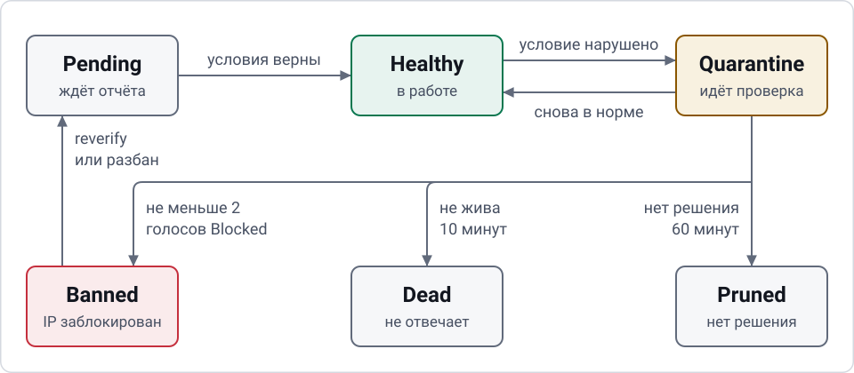

# Жизненный цикл ноды, бан, мастера и DNS

Страница объясняет, что пул делает с нодой с момента регистрации до удаления. Значения по умолчанию — настройки пула (поля API `settings`); их можно менять без перезапуска.

## Состояния

<picture><source media="(prefers-color-scheme: dark)" srcset="images/diagram-lifecycle-dark.svg"></picture>

| Состояние | Что значит |
|---|---|
| `Pending` | только зарегистрирована, ждёт первого верного отчёта |
| `Healthy` | все условия выполнены, нода может быть мастером |
| `Quarantine` | условие нарушено; нода снята с мастеров, идёт проверка |
| `Banned` | подтверждена блокировка IP; запись ноды удаляется в тот же момент, поэтому в API это состояние не встречается |
| `Dead` | нода не отвечает, снята или вытеснена; её IP не блокируется; запись удаляется через 24 часа |
| `Pruned` | решения не было долго; IP не блокируется; запись удаляется через 24 часа |

На схеме только основной путь. Все переходы:

| Откуда | Куда | Когда |
|---|---|---|
| регистрация | `Pending` | нода зарегистрировалась; с заблокированного IP — после паузы, в режиме reverify |
| `Pending` | `Healthy` | все условия верны |
| `Pending` | `Quarantine` | условие нарушено |
| `Pending` | `Dead` | не жива 10 минут |
| `Pending` с reverify | запись удалена | решающий раунд не показал чистоты |
| `Healthy` | `Quarantine` | условие нарушено |
| `Healthy` | `Pending` | сменился IP |
| `Quarantine` | `Healthy` | условия снова верны или прошло 2 чистых раунда |
| `Quarantine` | `Pending` | сменился IP |
| `Quarantine` | `Banned`, запись удалена | не меньше 2 голосов `Blocked` |
| `Quarantine` | `Dead` | не жива 10 минут |
| `Quarantine` | `Pruned` | нет решения 60 минут |
| `Pending`, `Healthy`, `Quarantine` | `Dead` | нода снята (`retire`), на её IP зарегистрировалась другая, её новый адрес нельзя принять, или её вытеснила новая нода владельца |
| `Dead`, `Pruned` | запись удалена | прошло 24 часа |

## Healthy

Нода может быть мастером, только если одновременно верно всё:

- TCP-защёлка в норме. Регистратор проверяет порт раз в `tcp_probe_interval_sec` (5) с таймаутом `tcp_probe_timeout_sec` (3). Защёлка падает после `latch_fail_threshold` (3) неудач подряд и поднимается после `latch_ok_threshold` (2) успехов.
- Защёлка метрик в норме: те же пороги по отчётам агента.
- Последняя проверка Globalping подтверждена регистратором и успешна.
- Порт ноды совпадает с `proxy_port`.
- Heartbeat моложе `heartbeat_ttl_sec` (60), отчёт моложе `report_max_age_sec` (900).

Если любое условие перестаёт выполняться, нода уходит в `Quarantine`. Порядок в очереди: время постановки, время регистрации, идентификатор.

## Quarantine

При входе нода сразу снимается с мастеров; домен перейдёт на другую ноду на ближайшем тике выбора (тик раз в 3 секунды).

Сначала проверяется, жива ли нода: heartbeat свежий и порт TCP открыт снаружи.

- **Не жива.** Сенсоры не запускаются: упавший сервер не считается заблокированным. Если нода непрерывно нежива `dead_after_sec` (600), она становится `Dead`. Её IP не блокируется, повторная регистрация свободна.
- **Жива, Globalping в норме, не выполнено другое условие** (метрики, порт). Сенсоры не запускаются. Как только все условия Healthy выполнены, нода сразу возвращается в `Healthy`.
- **На ноде занято имя пользователя пула** (`pool_user_taken`). Сенсоры не запускаются, даже если замер Globalping провален: секрета и домена пула на этой ноде нет, так что сенсор ничего не узнает об адресе. Причина описана в [add-node.md](add-node.md#как-агент-обращается-с-конфигурацией-движка).
- **Жива, последний замер Globalping провален или его нет.** Запускается раунд сенсоров каждые `round_interval_sec` (300). После `rounds_before_slow` (3) раундов без решения интервал растёт до `round_interval_slow_sec` (900).

Итог раунда:

| Голоса | Решение |
|---|---|
| `Blocked` ≥ 2 | `Banned` |
| `Blocked` = 0, ответили ≥ 2, все условия Healthy выполнены | чистый раунд; `clean_rounds_to_exit` (2) чистых подряд — `Healthy` |
| всё остальное | ждём следующий раунд |

Если решения нет `quarantine_max_sec` (3600), нода становится `Pruned`. Повторная регистрация получает 429 с растущей паузой: 15 минут, затем 30 минут, 1, 2 и 3 часа. Так расход лимитов сенсоров ограничен, а нехватка сенсоров не приводит к бану.

## Бан

Бан заносит IP в список блокировок и в том же действии удаляет запись ноды вместе с её токеном. Занятые ею слоты мастера освобождаются сразу, домен переходит на другую ноду на ближайшем тике; пустой набор записей в DNS не отправляется. Строка в истории банов хранит все голоса. Эта строка, журнал, раунды сенсоров и история доступности не удаляются.

**У забаненной ноды больше нет записи: её нет в таблицах нод и счётчиках, страница ноды в API отвечает 404.** Бан живёт в истории банов (`GET /api/v1/bans`, раздел «История» в панели) и в журнале. Снять его можно и без записи: `POST /api/v1/admin/nodes/{id}/unban` находит блокировку по идентификатору забаненной ноды или ноды из открытой строки истории. На практике после бана сервер обычно пересоздают или меняют ему IP.

Записи `Dead` и `Pruned` удаляются вместе с токеном через 24 часа после входа в это состояние. Пауза повторной регистрации после `Pruned` хранится отдельно и живёт дольше. Записи `Banned`, оставшиеся в базе от прошлых версий, удаляются первым тиком после обновления.

### Reverify

Первая проверка возможна через `reverify_pause_sec` (900) после бана. До этого регистрация с заблокированного IP получает 429 с `Retry-After`, лимиты сенсоров не тратятся. После паузы регистрация создаёт ноду в режиме reverify и сразу запускает решающий раунд:

- Чистый раунд (`Blocked` = 0, ответили не меньше двух) снимает блокировку, нода переходит в `Pending`, событие — `ban.lifted`.
- Иначе блокировка остаётся, запись этой ноды удаляется, событие — `node_reverify_failed` (только в журнале). Следующая попытка через `reverify_pause_sec`.

Агент забаненной ноды делает это сам. Следующий запрос получает 401, агент удаляет токен и регистрируется заново, а паузу выжидает по `Retry-After`. Администратор может снять бан вручную; действие попадает в аудит, агент после этого снова зарегистрируется сам. Смена IP сбрасывает состояние ноды: это новая проверка.

## Лимит нод владельца

Сколько нод может быть у владельца, решает ядро пула при регистрации. Считаются записи `Pending`, `Healthy` и `Quarantine`. Порядок проверок:

1. Отказы по адресу: блокировка, пауза, идущий reverify. Ответ 429, лимит и другие ноды не затрагиваются.
2. Живая нода на том же IP уступает место новой, отдельное место для этого не нужно. Если та нода чужая, место владельцу новой всё равно нужно.
3. Есть свободное место: нода входит.
4. Лимит занят ровно, и среди нод владельца есть молчащая (последний heartbeat старше `heartbeat_ttl_sec`, 60 секунд): дольше всех молчащая нода становится `Dead`, событие `node.dead` с `{"replaced_by": <новая нода>, "reason": "silent"}`, а новая входит.
5. Иначе `403 owner_limit`. Агент повторяет попытку с растущей паузой, не больше 5 минут.

Никого не вытесняют: нода с заблокированного IP, регистрация при лимите, сниженном ниже числа нод, и любая регистрация в первые `heartbeat_ttl_sec` после запуска регистратора, пока ноды не успели подтвердить, что живы.

## Смена адреса

Агент проверяет свой адрес раз в 45 секунд, в том числе в паузе (`429`) и после `403 terminate`. На новом адресе он сперва пытается снять старую запись (`/agent/retire`, не дольше 3 секунд, неудача не мешает), затем сразу регистрируется заново, не дожидаясь окончания паузы. Если адрес поменялся без повторной регистрации, heartbeat с нового адреса начинает проверку заново; в журнале остаётся `node_ip_changed` с `from` и `to`.

## Выбор мастеров

- На свободный слот домена назначается наименее загруженная нода, затем по очереди. IP на домене различаются.
- Ротация по времени: раз в `rotation_ttl_sec` (1800) меняется один слот на домен, заменённая нода уходит в хвост очереди. 0 выключает ротацию.
- Снятого мастера заменяет следующая нода. Пустая очередь не очищает назначения.
- Нода без доменов может забрать один слот у самого загруженного донора. Полной перебалансировки нет.
- Мастеров на домен: `masters_per_domain`, от 1 до 8.

## DNS

Пул ведёт записи доменов из `domains` в Cloudflare.

- Модель «желаемое/применённое»: изменения применяются воркером, при ошибках повтор с растущей паузой от 5 секунд до 5 минут. Сначала создаются новые записи, потом удаляются лишние.
- A-записи мастеров с TTL `dns_ttl` (60, меньше 60 нельзя). Записи **без проксирования**: `dns_proxied` по умолчанию `false`, и так должно оставаться, потому что MTProto не работает через прокси Cloudflare.
- Каждая запись пула несёт комментарий `MTPooL`. Пул читает записи только под именами своих доменов и удаляет только записи типов A, AAAA и CNAME с этим комментарием. Остальное в зоне он не трогает.
- Пустой желаемый набор считается ошибкой и не применяется.
- Запросы к Cloudflare ограничены: 3 в секунду, таймаут запроса 15 секунд.
- Принудительно применить записи: `POST /api/v1/admin/dns/push`.

Адрес самого регистратора — запись, созданная вручную. Не включайте её в `domains`.

## СРМД: автомасштабирование доменов

По умолчанию выключено (`srmd.enabled: false`). Включённая, она подбирает число доменов под размер очереди нод.

- Нужное число доменов: `max(1, ceil(очередь / (max_nodes_per_domain × masters_per_domain)))`. `max_nodes_per_domain` по умолчанию 5, `max_domains` — не больше 50.
- Расхождение должно держаться `diverge_ticks` (20) тиков подряд, то есть около минуты; затем выполняется одно действие.
- Рост: сначала разворачиваются свёрнутые домены, затем создаются новые.
- Сжатие: лишние домены сворачиваются в CNAME на наименее загруженный оставшийся. CNAME всегда указывает на активный домен.
- Вручную: `POST /api/v1/admin/srmd/{domain}/take` и `.../release`.
- Имена новых доменов растут от базового имени `srmd.base_domain`. Если оно пусто, базовым берётся первый домен списка. Подробности и ловушка — в [operations.md](operations.md#имена-новых-доменов-срмд).
