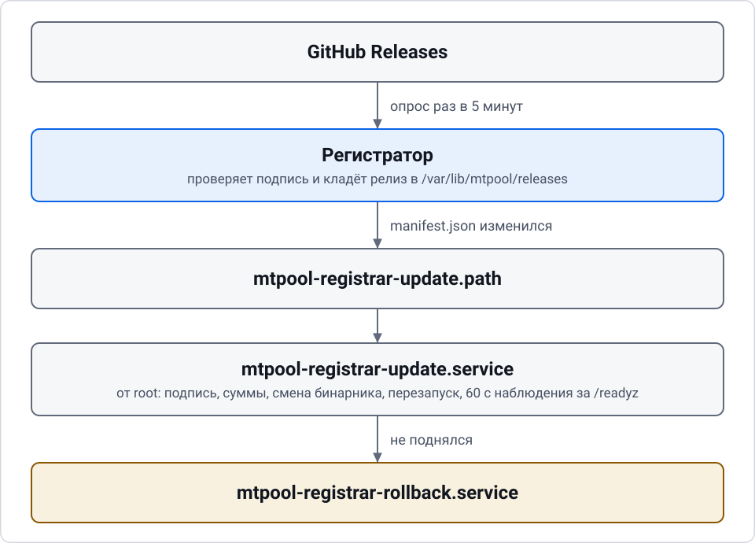

# Эксплуатация

Обновления, откат, резервные копии и диагностика регистратора. Установка — в [install-registrar.md](install-registrar.md), ноды — в [add-node.md](add-node.md).

## Имена новых доменов СРМД

Автомасштабирование (`srmd.enabled: true`, см. [lifecycle.md](lifecycle.md#срмд-автомасштабирование-доменов)) создаёт домены по схеме: имя до первой точки базового домена плюс номер, затем остаток.

| Базовое имя | Новые домены |
|---|---|
| `mt.example.com` | `mt1.example.com`, `mt2.example.com`, ... |
| `mt1.example.com` | `mt11.example.com`, `mt12.example.com`, ... |

Базовое имя берётся из `srmd.base_domain`. **Если оно пусто, базовым становится первый домен из списка `domains`.** Отсюда ловушка: если первый домен уже называется `mt1.example.com`, новые получат имена `mt11`, `mt12`, а не `mt2`.

Что сделать:

1. Перед включением СРМД задайте `srmd.base_domain` явно, например `mt.example.com`. Имя должно содержать точку не в начале и не в конце.
2. Номера идут с 1, уже занятые имена пропускаются. Домены, которые вы создали вручную, СРМД не сворачивает: они остаются активными.
3. Предел числа доменов — `srmd.max_domains` (1–50).

```bash
curl -s -X PATCH https://pool.example.com/api/v1/admin/settings \
  -H "Authorization: Bearer $MTPOOL_ADMIN_TOKEN" -H 'Content-Type: application/json' \
  -d '{"srmd":{"enabled":true,"base_domain":"mt.example.com"}}'
```

Домены остаются записями Cloudflare с комментарием `MTPooL`, TTL не меньше 60 и без проксирования.

## Обновление регистратора

Регистратор сам проверяет новый релиз и ставит его. В обновлении участвуют три юнита:

| Юнит | Роль |
|---|---|
| `mtpool-registrar-update.path` | следит за файлом `/var/lib/mtpool/releases/manifest.json`; манифест записывается последним, поэтому его изменение означает, что релиз получен целиком |
| `mtpool-registrar-update.service` | под root выполняет `mtpool-registrar update apply`: проверяет подпись и контрольные суммы заново, меняет бинарник, перезапускает регистратор и 60 секунд следит за `/readyz` |
| `mtpool-registrar-rollback.service` | запускается, если новая сборка не поднялась: предыдущая сборка (`/usr/local/bin/mtpool-registrar.prev`) возвращает себя на место |

Сам сервис регистратора работает от пользователя `mtpool` с read-only системой и писать в `/usr/local/bin` не может. Права root есть только у узкого юнита обновления.

Как это идёт:

<picture><source media="(prefers-color-scheme: dark)" srcset="images/diagram-update-dark.svg"></picture>

Включено или выключено обновление, определяет строка `MTPOOL_RELEASE_REPO` в `/etc/mtpool/registrar.env`. Установщик пишет её при первой установке (по умолчанию `SkyDeaD/MTPooL`, можно задать `--release-repo`). **Удалите эту строку и перезапустите регистратор, и самообновление выключится.** Релизы подписаны ключом `minisign`; открытый ключ вшит в бинарник, и подпись проверяется при загрузке и перед установкой.

Состояние:

```bash
systemctl status mtpool-registrar-update.path
journalctl -u mtpool-registrar-update -u mtpool-registrar-rollback -n 100 --no-pager
mtpool-registrar version
```

Также в журнале регистратора (`journalctl -u mtpool-registrar`) видно, когда самообновление включено (`self-update is on`).

### Откат

Автоматический откат происходит, если после обновления `/readyz` не отвечает в течение наблюдения. Юнит отката ничего не делает, если обновления на испытании нет, поэтому его запуск вручную безопасен:

```bash
sudo systemctl start mtpool-registrar-rollback.service
```

Сборка отказывается открывать базу новее себя. Поэтому перед миграцией схемы регистратор кладёт копию базы рядом с ней: `/var/lib/mtpool/registrar.db.before-v<версия схемы>`. Без копии миграция не начнётся. Сборка, вернувшаяся откатом, находит базу новее себя и забирает эту копию, если ей меньше 10 минут. Всё, что новая сборка успела записать, теряется. В журнале появляется предупреждение `went back to the copy from before the migration`.

Хранится одна копия: следующая миграция заменяет её. В копии те же данные, что и в базе, а права на неё такие же.

Сборки `0.0.3` и старше забирать копию не умеют. Если откат вернул такую сборку или копия старше 10 минут, регистратор не запустится и напишет `database schema version ... is newer than this build supports`. Верните копию вручную (`7` здесь: версия схемы сборки `0.0.3`):

```bash
sudo systemctl stop mtpool-registrar
sudo mtpool-registrar restore --from /var/lib/mtpool/registrar.db.before-v7
sudo systemctl start mtpool-registrar
```

Если автоматика не помогла, верните данные из ежедневной копии (см. ниже) и бинарник из нужного релиза.

### Обновление нод

Агенты обновляются по решению регистратора, а не сами по себе. Когда в каталоге релизов появляется подписанный релиз с более новой версией агента, начинается раскатка: сначала одна нода (канарейка), за ней наблюдение, затем пачки.

Агент новее самого регистратора не раздаётся: релиз ждёт, пока обновится регистратор, а в журнале остаётся запись. Если регистратор откатился, незаконченная раскатка новой версии отменяется с причиной `registrar_behind`. Ноды, которые уже обновились, остаются на новой версии. Установить новую ноду в это время нельзя: `GET /releases/manifest.json` отвечает 409 `registrar_behind`, и `install.sh` останавливается с объяснением, потому что более старой сборки агента в каталоге нет. Повторите установку, когда регистратор дойдёт до этой версии. При обновлении вручную сначала обновите регистратор.

Релиз не новее регистратора тоже попадает в каталог, если там нет релиза или лежит более старый: с него ставятся новые ноды. Регистратор при этом себя не заменяет. Отсюда две заметные вещи. На свежем регистраторе в журнале раскаток появляется завершённая раскатка без нод. После ручного обновления регистратора до последнего релиза этот релиз раскатывается на старые ноды.

Раскатку видно и ею можно управлять:

| Запрос | Что делает |
|---|---|
| `GET /api/v1/admin/rollouts` | список раскаток, новые первыми |
| `GET /api/v1/admin/rollouts/{id}` | состояние, причина ожидания или остановки, нода и этап каждого участника |
| `POST /api/v1/admin/rollouts/{id}/resume` | продолжить приостановленную раскатку (409 `not_paused`, если она не на паузе) |
| `POST /api/v1/admin/rollouts/{id}/cancel` | отменить (409 `rollout_over`, если она уже закончена) |

Параметры раскатки — раздел `rollout` настроек: `observe_sec` 600 (наблюдение за канарейкой), `batch_interval_sec` 300, `batch_percent` 10, `return_sec` 120, `offer_wait_sec` 300. Нода, не принявшая обновление, повторно в этой раскатке не пробуется. Если новая версия на ноде не поднялась, агент возвращает старую (юнит `mtpool-agent-rollback`).

Версии агента и регистратора могут временно различаться в обе стороны: релиз остаётся в каталоге релизов и после отката регистратора, а ноды, успевшие обновиться до отката, остаются на новой версии. Такой агент отправляет отчёт прежнего вида, пока `GET /api/v1/agent/config` не подтвердит поддержку нового (`report_other_users`). Настройки агент запрашивает раз в `sync_interval_sec` (60 секунд), поэтому сразу после отката регистратора один-два отчёта могут получить 400. На состояние ноды это не влияет: отчёт считается устаревшим только через `report_max_age_sec` (900 секунд).

Пул считает клиентов и трафик только своих пользователей. После обновления агента на ноде с пользователями владельца на графиках возможна ступенька вниз: старые точки содержат сумму по всем пользователям движка, и пересчитать их нельзя. Первый отчёт нового вида только задаёт базу счётчиков, поэтому всплеска трафика не будет. То же при откате агента. Трафик пользователей владельцев на дашборде показан отдельно и считается во времени с той версии регистратора, которая начала его хранить. Определение — в разделе 9 [спецификации](specs/2026-11-03-mtpool-design.md).

## Резервные копии

Копия базы делается ежедневно таймером `mtpool-backup.timer`: `mtpool-backup.service` пишет `/var/backups/mtpool/registrar-<дата>.db` и удаляет копии старше 7 дней.

```bash
systemctl list-timers mtpool-backup.timer
sudo ls -l /var/backups/mtpool/
```

Вручную:

```bash
sudo runuser -u mtpool -- mtpool-registrar backup --to /var/backups/mtpool/manual.db
```

Рядом с файлом создаётся `manual.db.sha256`. Восстановление требует эту сумму, а регистратор должен быть остановлен:

```bash
sudo systemctl stop mtpool-registrar
sudo mtpool-registrar restore --from /var/backups/mtpool/manual.db
sudo systemctl start mtpool-registrar
```

Восстановление можно запускать от root: владелец файла базы сохраняется, поэтому регистратор (пользователь `mtpool`) откроет её после запуска. Команда печатает `restored; start the registrar again`.

Копия содержит токены (в хэшированном виде), настройки и истории. Секреты Cloudflare, Globalping и RedFlag, заданные в панели, лежат в базе, поэтому храните копии так же бережно, как саму базу, и не выкладывайте их в публичные места.

## Диагностика

Начните с проб и журнала:

```bash
systemctl status mtpool-registrar mtpool-registrar.socket
journalctl -u mtpool-registrar -n 200 --no-pager
curl -s -o /dev/null -w '%{http_code}\n' http://127.0.0.1:8080/healthz
curl -s -o /dev/null -w '%{http_code}\n' http://127.0.0.1:8080/readyz
```

- `/healthz` и `/readyz` возвращают `ok` и 200, когда регистратор жив и готов. Проверку обновления решает именно `/readyz`.
- Уровень журнала задаёт `MTPOOL_LOG` (по умолчанию `info`), например `MTPOOL_LOG=debug` в `/etc/mtpool/registrar.env`. Значение понимается как фильтр `tracing`: `info,mtpool_registrar=debug`.
- Метрики: `GET /metrics` с токеном вида `mtp_metrics_...` (выпускается как `kind: "metrics"`). Без токена ответ 401.

Что смотреть в API (токен администратора):

| Запрос | Что показывает |
|---|---|
| `GET /api/v1/admin/status` | внешние сервисы, DNS, счётчики за сутки и неделю |
| `GET /api/v1/admin/events` | журнал событий пула |
| `GET /api/v1/admin/audit` | аудит действий администратора |
| `GET /api/v1/admin/stream` | поток событий для панели |
| `GET /api/v1/admin/nodes` | все ноды с состоянием |
| `GET /api/v1/admin/srmd` | состояние автомасштабирования |

Частые причины:

| Симптом | Куда смотреть |
|---|---|
| Нода не становится `Healthy` | порт движка равен `proxy_port`? TCP-доступность порта снаружи, свежесть heartbeat, голос Globalping на странице ноды |
| Нода в карантине без бана | все голоса `Abstain`? Ключи сенсоров: [sensors.md](sensors.md) |
| Домен не обновляется | `GET /api/v1/admin/status`, раздел DNS; токен Cloudflare; принудительно `POST /api/v1/admin/dns/push` |
| Ноды выпадают из пула после смены `tcp_probe_interval_sec` | значение меньше 2 секунд убивает ноды MTProxyL: у них ограничение nft примерно в одно новое соединение в секунду с одного источника |
| Забаненную ноду не найти в таблице | так и задумано: бан хранится в истории банов и журнале, см. [lifecycle.md](lifecycle.md#бан) |
| Бот не получает события | журнал доставок подписки, см. [bots.md](bots.md) |

Секрет администратора утерян — `sudo runuser -u mtpool -- mtpool-registrar admin reset-token` выдаёт новый токен (см. [install-registrar.md](install-registrar.md)).
